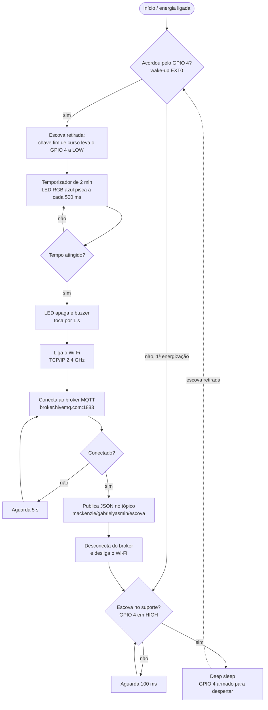
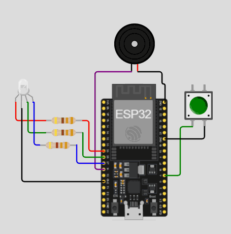
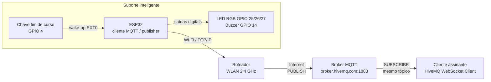

# Suporte Inteligente para Escova de Dentes (ESP32 + MQTT)

Projeto final da disciplina de Internet das Coisas — Faculdade de Computação e Informática (FCI), Universidade Presbiteriana Mackenzie.

**Autores:** Gabriel Oliveira Sarmento e Yasmin Keller

**Vídeo de demonstração:** https://youtu.be/2IL4a8Cc4B0

**Simulação no Wokwi:** https://wokwi.com/projects/479811130542022657

O projeto é um suporte de parede para escova de dentes que orienta o usuário a escovar pelo tempo recomendado de 2 minutos e registra cada escovação na nuvem pelo protocolo MQTT. O histórico de uso permite estimar quando a escova deve ser trocada (ciclo de referência de 90 dias). A proposta está alinhada ao Objetivo de Desenvolvimento Sustentável 3 da ONU (Saúde e Bem-Estar).

---

## 1. Funcionamento e uso

1. O suporte fica "dormindo" (modo *deep sleep* do ESP32) enquanto a escova está apoiada, gastando o mínimo de bateria.
2. Quando o usuário retira a escova, a chave fim de curso muda de estado e acorda o microcontrolador.
3. O LED RGB começa a piscar em azul e continua piscando durante os 2 minutos de escovação.
4. Ao final do tempo, o LED apaga e o buzzer emite um bipe de 1 segundo.
5. O ESP32 liga o Wi-Fi, conecta ao broker MQTT e publica o registro da escovação.
6. Em seguida desliga o Wi-Fi, espera a escova ser devolvida ao suporte e volta a dormir.



### Como reproduzir

**Opção A — Simulação no Wokwi (sem hardware)**

1. Abra o projeto em <https://wokwi.com/projects/479811130542022657> (os arquivos também estão na pasta [`simulacao-wokwi/`](simulacao-wokwi/)) ou crie um projeto ESP32 em <https://wokwi.com> e copie os arquivos `sketch.ino`, `diagram.json` e `libraries.txt` dessa pasta.
2. Clique em **Start Simulation**. O Wokwi conecta automaticamente à rede virtual `Wokwi-GUEST`.
3. Abra em outra aba o cliente MQTT web da HiveMQ: <https://www.hivemq.com/demos/websocket-client/>.
4. Clique em **Connect**, depois em **Add New Topic Subscription** e assine o tópico `mackenzie/gabrielyasmin/escova`.
5. No simulador, pressione o botão verde (ele representa a retirada da escova). Aguarde o LED piscar e o bipe; a mensagem JSON aparece no cliente da HiveMQ.

> Na simulação o tempo de escovação foi reduzido para 10 segundos para agilizar os testes. O *deep sleep* é representado por um estado de repouso em software, porque o Wokwi não reproduz o despertar real do chip.

**Opção B — Montagem física**

1. Monte o circuito conforme a tabela de ligações da seção 3 e o diagrama abaixo.
2. Instale a [Arduino IDE](https://www.arduino.cc/en/software) e adicione o suporte a placas ESP32 (Gerenciador de Placas → "esp32" da Espressif).
3. Instale a biblioteca **PubSubClient** (Nick O'Leary) pelo Gerenciador de Bibliotecas.
4. Abra [`firmware/smart_toothbrush/smart_toothbrush.ino`](firmware/smart_toothbrush/smart_toothbrush.ino), preencha `ssid` e `password` com os dados da sua rede 2,4 GHz e selecione a placa **ESP32 Dev Module**.
5. Grave o firmware, apoie a escova no suporte e acompanhe as mensagens pelo cliente MQTT, como na opção A.

---

## 2. Software

O firmware foi escrito em **C++** com o **Arduino Core para ESP32**. Diferente de um sketch tradicional, ele não usa o `loop()`: toda a lógica roda uma vez dentro do `setup()` e termina com `esp_deep_sleep_start()`. Cada vez que a escova é retirada, o chip reinicia a partir do `setup()`.

| Arquivo | Descrição |
|---|---|
| `firmware/smart_toothbrush/smart_toothbrush.ino` | Firmware para o hardware físico, com *deep sleep* real |
| `simulacao-wokwi/` | Versão usada na simulação e no vídeo de demonstração |
| `docs/software.md` | Documentação do código, função por função |

**Bibliotecas:** `WiFi.h` (pilha TCP/IP do ESP32, incluída no core) e `PubSubClient.h` (cliente MQTT).

Detalhes em [`docs/software.md`](docs/software.md).

---

## 3. Hardware



| Componente | Qtd. | Função |
|---|---|---|
| ESP32 DevKitC V4 (ESP-WROOM-32) | 1 | Microcontrolador com Wi-Fi integrado |
| Chave fim de curso KW12-3 com roldana | 1 | **Sensor**: detecta a presença da escova |
| LED RGB 5 mm cátodo comum | 1 | **Atuador** visual |
| Resistor 330 Ω | 3 | Limitação de corrente do LED |
| Buzzer piezoelétrico 5 V | 1 | **Atuador** sonoro |
| Bateria Li-Po 3,7 V 700 mAh | 1 | Alimentação |
| Módulo carregador TP4056 (micro-USB) | 1 | Recarga da bateria |
| Chave gangorra ON/OFF | 1 | Corte geral de energia |
| Case impresso em 3D | 1 | Invólucro e berço da escova |

### Ligações

| ESP32 | Componente |
|---|---|
| GPIO 4 | Chave fim de curso — contato NF/NC (terminal comum no GND; pull-up interno) |
| GPIO 25 | LED RGB — vermelho (via 330 Ω) |
| GPIO 26 | LED RGB — verde (via 330 Ω) |
| GPIO 27 | LED RGB — azul (via 330 Ω) |
| GPIO 14 | Buzzer (+) |
| GND | Cátodo do LED, buzzer (−), chave fim de curso |

### Invólucro (impressão 3D)

Case em polímero (PLA ou PETG) com dimensões estimadas de **150 mm × 45 mm × 35 mm**, fixação em parede e berço anatômico que mantém a escova apoiada sobre a alavanca do microswitch. A bateria, o TP4056 e o ESP32 ficam no compartimento interno; o LED, o buzzer, a chave gangorra e a entrada micro-USB ficam acessíveis pela face frontal/inferior.

Especificações completas em [`docs/hardware.md`](docs/hardware.md).

---

## 4. Comunicação: TCP/IP e MQTT



| Item | Valor |
|---|---|
| Rede | Wi-Fi nativo do ESP32 (802.11 b/g/n, 2,4 GHz), TCP/IP |
| Protocolo de aplicação | MQTT 3.1.1 |
| Broker | `broker.hivemq.com` (público) |
| Porta | 1883 (TCP, sem TLS) |
| Papel do ESP32 | *Publisher* (não assina tópicos) |
| Tópico | `mackenzie/gabrielyasmin/escova` |
| QoS | 0 |
| Formato da mensagem | JSON |

Exemplo de mensagem publicada:

```json
{"evento":"escovacao_concluida", "duracao_segundos": 120}
```

O ESP32 só liga o Wi-Fi depois do fim da escovação, publica a mensagem e desliga o rádio logo em seguida. Por isso ele não assina nenhum tópico: manter o rádio ligado esperando mensagens consumiria a bateria.


Detalhes em [`docs/comunicacao.md`](docs/comunicacao.md).

---

## 5. Estrutura do repositório

```
├── README.md
├── firmware/
│   └── smart_toothbrush/
│       └── smart_toothbrush.ino
├── simulacao-wokwi/
│   ├── README.md
│   ├── sketch.ino
│   ├── diagram.json
│   └── libraries.txt
└── docs/
    ├── hardware.md
    ├── software.md
    ├── comunicacao.md
    └── img/
```
