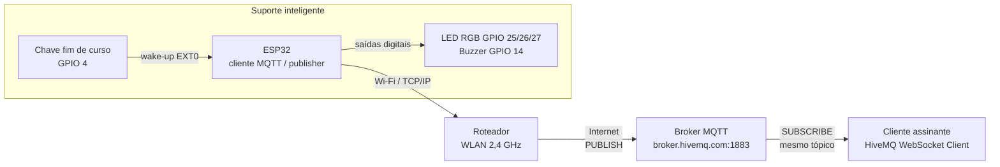
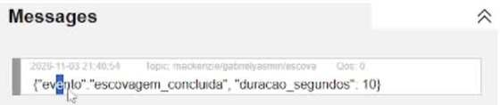

# Interfaces, protocolos e módulos de comunicação

## Visão geral



O dispositivo se comunica com a internet em duas camadas:

1. **Rede (TCP/IP sobre Wi-Fi):** o módulo de rádio Wi-Fi integrado ao ESP32 conecta-se à rede doméstica (WLAN 2,4 GHz), recebe um endereço IP por DHCP e acessa a internet pelo roteador. A biblioteca `WiFi.h` do Arduino Core cuida dessa conexão.
2. **Aplicação (MQTT):** sobre uma conexão TCP, o ESP32 fala MQTT com um broker na nuvem usando a biblioteca `PubSubClient`.

Não há módulo de comunicação externo: o rádio Wi-Fi faz parte do próprio ESP32, então não é necessária nenhuma ponte serial/USB (como Firmata) entre o microcontrolador e o broker.

## Por que MQTT

O MQTT é um protocolo de mensagens do tipo *publish/subscribe*, criado para dispositivos com pouca memória, pouca energia e redes instáveis. O cabeçalho mínimo tem 2 bytes, a conexão é curta e o dispositivo não precisa conhecer quem vai receber os dados: ele só publica em um tópico, e o broker entrega a mensagem a todos os assinantes. Isso combina com um aparelho a bateria que liga o rádio por poucos segundos.

## Parâmetros

| Parâmetro | Valor | Onde está no código |
|---|---|---|
| Broker | `broker.hivemq.com` | `mqtt_server` |
| Porta | 1883 (TCP, sem criptografia) | `mqtt_port` |
| Tópico | `mackenzie/gabrielyasmin/escova` | `mqtt_topic` |
| Client ID | `ESP32-Holder-` + número hexadecimal aleatório | `reconnect()` |
| QoS | 0 (no máximo uma entrega) | padrão do `client.publish()` |
| Retain | não | padrão do `client.publish()` |
| Papel | apenas *publisher* | — |

O Client ID aleatório evita que duas instâncias (por exemplo, a simulação e a placa física) derrubem a conexão uma da outra no broker público.

## Formato da mensagem

```json
{"evento":"escovacao_concluida", "duracao_segundos": 120}
```

| Campo | Tipo | Descrição |
|---|---|---|
| `evento` | texto | Tipo de evento registrado |
| `duracao_segundos` | inteiro | Duração do ciclo de escovação |

O horário de chegada é registrado pelo próprio broker/cliente assinante, por isso não é enviado no JSON.

## Sequência de mensagens

```
ESP32                         Broker HiveMQ                 Assinante
  |   (escova retirada, 2 min de LED, bipe)                    |
  |-- conexão TCP :1883 ------->|                              |
  |-- CONNECT (client id) ----->|                              |
  |<-------------- CONNACK -----|                              |
  |-- PUBLISH (tópico, JSON) -->|-- PUBLISH (tópico, JSON) --->|
  |-- DISCONNECT -------------->|                              |
  |   (Wi-Fi desligado, deep sleep)                            |
```

## Como ver as mensagens

1. Abra <https://www.hivemq.com/demos/websocket-client/>.
2. Clique em **Connect** (os valores padrão já apontam para `broker.hivemq.com`).
3. Em **Subscriptions**, clique em **Add New Topic Subscription** e digite `mackenzie/gabrielyasmin/escova`.
4. Faça um ciclo de escovação (ou pressione o botão no Wokwi). A mensagem aparece em **Messages**.

Também é possível usar qualquer cliente MQTT de linha de comando, por exemplo:

```
mosquitto_sub -h broker.hivemq.com -p 1883 -t mackenzie/gabrielyasmin/escova -v
```



## Limitações e melhorias previstas

- O broker público não tem autenticação nem criptografia; qualquer pessoa que conheça o tópico pode ler as mensagens. Uma versão futura deve usar TLS (porta 8883) e usuário/senha em um broker privado.
- Se o Wi-Fi estiver indisponível, o registro daquele ciclo é perdido. Uma melhoria é guardar os eventos na memória RTC do ESP32 e enviá-los no próximo ciclo.
