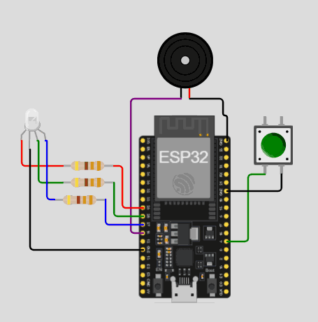

# Hardware

## Plataforma de desenvolvimento

**ESP32 DevKitC V4 (módulo ESP-WROOM-32)**

- SoC Espressif ESP32, dual-core Xtensa LX6 de 32 bits, até 240 MHz
- Wi-Fi 802.11 b/g/n (2,4 GHz) e Bluetooth integrados
- Coprocessador ULP e modo *deep sleep* com consumo na faixa de microampères
- Alimentação de 3,3 V na lógica; aceita 5 V pelo USB/pino VIN

O ESP32 foi escolhido no lugar do Arduino Uno (sem rede nativa), do NodeMCU/ESP8266 (menos GPIOs e menos recursos de economia de energia) e do Raspberry Pi (custo e consumo altos para uma aplicação a bateria).

## Sensor

**Chave fim de curso (microswitch) KW12-3 com haste e roldana**

- Contatos: Comum (C), Normalmente Aberto (NA/NO) e Normalmente Fechado (NF/NC)
- Ligação usada: **C → GND** e **NF → GPIO 4**, com o resistor de *pull-up* interno do ESP32 ativado (`INPUT_PULLUP`)
- Escova apoiada: a alavanca fica pressionada, o contato NF abre e o GPIO 4 lê **HIGH**
- Escova retirada: a alavanca é liberada, o contato NF fecha para o GND e o GPIO 4 vai para **LOW**, o que dispara o despertar EXT0 do ESP32

Na simulação no Wokwi a chave é representada por um *pushbutton*: pressionar o botão equivale a retirar a escova.

## Atuadores

**LED RGB 5 mm, cátodo comum**

- Ânodos ligados aos GPIOs 25 (vermelho), 26 (verde) e 27 (azul), cada um em série com um resistor de 330 Ω
- Cátodo comum no GND
- Com 3,3 V no GPIO, a corrente fica entre ~1 mA (canal azul, queda de ~3,0 V) e ~4 mA (canal vermelho, queda de ~2,0 V), bem abaixo do limite dos pinos do ESP32
- Função: pisca em azul (500 ms ligado / 500 ms desligado) durante o tempo de escovação

**Buzzer piezoelétrico 5 V**

- Positivo no GPIO 14, negativo no GND
- Função: bipe de 1 segundo ao final da escovação

## Alimentação

| Componente | Especificação | Função |
|---|---|---|
| Bateria Li-Po | 3,7 V, 700 mAh | Fonte principal |
| Módulo TP4056 | Entrada micro-USB 5 V, carga CC/CV até 1 A, proteção de sobrecarga/descarga | Recarga segura da bateria |
| Chave gangorra | SPST, ON/OFF | Corte geral entre bateria e circuito |

Ligação: bateria → TP4056 (B+/B−) → chave gangorra → pino 3V3/VIN do ESP32 e GND comum.

O Wokwi não simula bateria nem circuito de carga, por isso esses itens aparecem apenas no projeto físico. Na simulação o ESP32 é alimentado por uma fonte ideal.

## Invólucro (impressão 3D)

| Característica | Valor |
|---|---|
| Material sugerido | PLA ou PETG |
| Dimensões externas estimadas | 150 mm (altura) × 45 mm (largura) × 35 mm (profundidade) |
| Fixação | Parede (fita dupla-face ou parafusos) |
| Berço | Encaixe anatômico que mantém o cabo da escova apoiado sobre a roldana do microswitch |
| Acessos externos | LED RGB e furação do buzzer na face frontal; entrada micro-USB do TP4056 e chave gangorra na lateral/inferior |

## Diagrama de montagem

