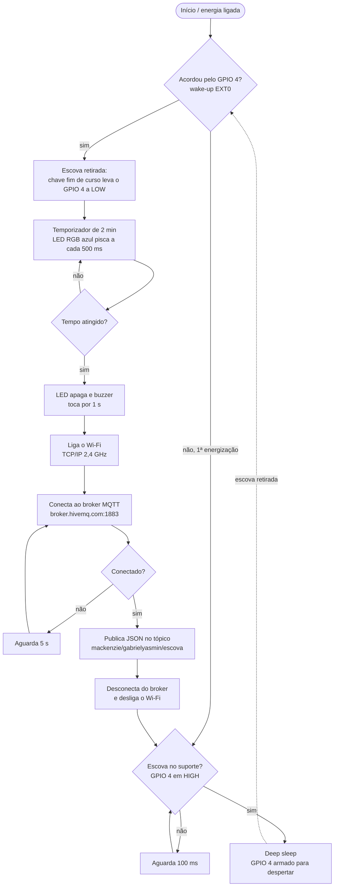

# Documentação do software

## Ambiente

| Item | Versão / valor |
|---|---|
| Linguagem | C++ (Arduino) |
| Core | Arduino Core para ESP32 (Espressif) |
| Placa na IDE | ESP32 Dev Module |
| Bibliotecas | `WiFi.h` (incluída no core), `PubSubClient` (Nick O'Leary) |
| Velocidade da serial | 115200 baud |

## Arquitetura

O firmware é orientado a eventos. Em vez de repetir um `loop()`, o programa executa uma única sequência dentro do `setup()` e termina colocando o chip em *deep sleep*. Ao acordar, o ESP32 reinicia e executa o `setup()` de novo; a função `esp_sleep_get_wakeup_cause()` informa se ele acordou pela retirada da escova (EXT0) ou se foi a primeira energização.



## Constantes de configuração

| Constante | Valor | Significado |
|---|---|---|
| `BTN_PIN` | 4 | Entrada da chave fim de curso (também é o pino de despertar) |
| `BUZZER_PIN` | 14 | Saída do buzzer |
| `LED_R`, `LED_G`, `LED_B` | 25, 26, 27 | Saídas do LED RGB |
| `ssid`, `password` | — | Credenciais da rede Wi-Fi |
| `mqtt_server` | `broker.hivemq.com` | Endereço do broker |
| `mqtt_port` | 1883 | Porta TCP do broker |
| `mqtt_topic` | `mackenzie/gabrielyasmin/escova` | Tópico de publicação |
| `TEMPO_ESCOVACAO` | 120000 ms | Duração da escovação (2 minutos) |

## Funções

### `setup_wifi()`
Inicia a conexão com `WiFi.begin(ssid, password)` e espera, em intervalos de 500 ms, até o status ser `WL_CONNECTED`.

### `reconnect()`
Enquanto o cliente MQTT não estiver conectado, gera um Client ID único (`ESP32-Holder-` + valor hexadecimal aleatório) e chama `client.connect()`. Se falhar, mostra o código de erro (`client.state()`) na serial e tenta de novo após 5 segundos.

### `setup()`
1. Inicia a serial e configura os pinos: `BTN_PIN` como `INPUT_PULLUP`, buzzer e LED como saída, todos em nível baixo.
2. Lê o motivo do despertar com `esp_sleep_get_wakeup_cause()`.
3. Se o motivo for `ESP_SLEEP_WAKEUP_EXT0` (escova retirada):
   - roda o temporizador de escovação com `millis()`, alternando o LED azul a cada 500 ms, sem bloquear o processador;
   - chama `yield()` dentro do laço para alimentar o *watchdog timer*;
   - ao final, apaga o LED e aciona o buzzer por 1 segundo;
   - chama `setup_wifi()`, configura o broker com `client.setServer()` e chama `reconnect()`;
   - publica o JSON `{"evento":"escovacao_concluida", "duracao_segundos": 120}` com `client.publish()`;
   - desconecta do broker e desliga o rádio (`WiFi.disconnect(true)` e `WiFi.mode(WIFI_OFF)`).
4. Espera a escova voltar ao suporte (`BTN_PIN` em HIGH). Sem essa espera, o chip acordaria de novo imediatamente, porque o pino ainda estaria em LOW.
5. Arma o despertar com `esp_sleep_enable_ext0_wakeup(GPIO_NUM_4, 0)` (acordar quando o pino for a 0) e entra em *deep sleep* com `esp_deep_sleep_start()`.

### `loop()`
Vazio. Nunca é executado, porque o `setup()` sempre termina em *deep sleep*.

## Pseudocódigo

```
ao iniciar:
    configurar pinos
    se acordou pela chave fim de curso:
        repetir por 2 minutos:
            a cada 500 ms inverter LED azul
        apagar LED
        tocar buzzer por 1 s
        conectar ao Wi-Fi
        enquanto não conectado ao broker: tentar conectar (espera 5 s entre tentativas)
        publicar {"evento":"escovacao_concluida","duracao_segundos":120} no tópico
        desconectar do broker e desligar Wi-Fi
    esperar a escova voltar ao suporte
    armar despertar no GPIO 4 em nível baixo
    entrar em deep sleep
```

## Diferenças da versão de simulação (Wokwi)

O Wokwi não reproduz o *deep sleep* real do ESP32. Por isso a versão em `simulacao-wokwi/`:

- usa a rede `Wokwi-GUEST` (sem senha);
- reduz o tempo de escovação para 10 segundos;
- representa o repouso por variáveis de estado (`modoRepouso`, `cicloAtivo`) em vez de `esp_deep_sleep_start()`.

A lógica de leitura do sensor, acionamento dos atuadores e publicação MQTT é a mesma nas duas versões.
