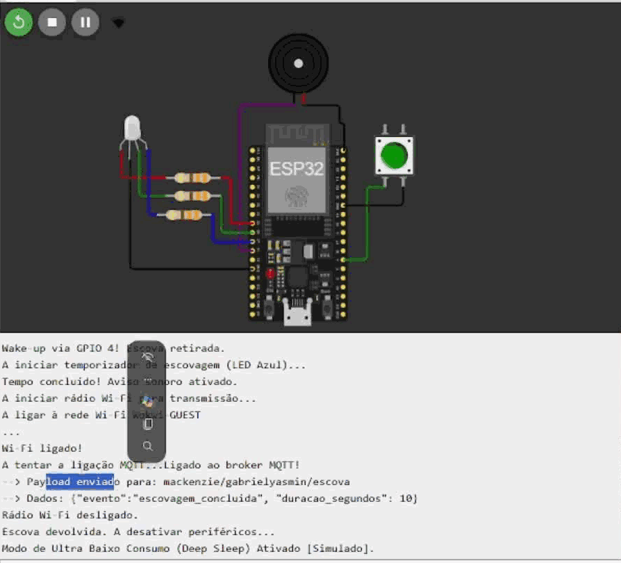

# Simulação no Wokwi

Versão do projeto usada nos testes e no vídeo de demonstração.

**Projeto no Wokwi:** LINK_DO_WOKWI

## Arquivos

| Arquivo | Conteúdo |
|---|---|
| `sketch.ino` | Código da simulação |
| `diagram.json` | Circuito (ESP32, LED RGB, resistores, buzzer e botão) |
| `libraries.txt` | Bibliotecas usadas pelo Wokwi (`PubSubClient`) |

## Como executar

1. Abra o link acima ou crie um projeto ESP32 em <https://wokwi.com> e substitua os três arquivos pelos desta pasta.
2. Clique em **Start Simulation** e aguarde a mensagem de repouso no monitor serial.
3. Assine o tópico `mackenzie/gabrielyasmin/escova` no cliente <https://www.hivemq.com/demos/websocket-client/>.
4. Pressione o botão verde (equivale a retirar a escova). O LED pisca em azul por 10 segundos, o buzzer toca e a mensagem é publicada.

